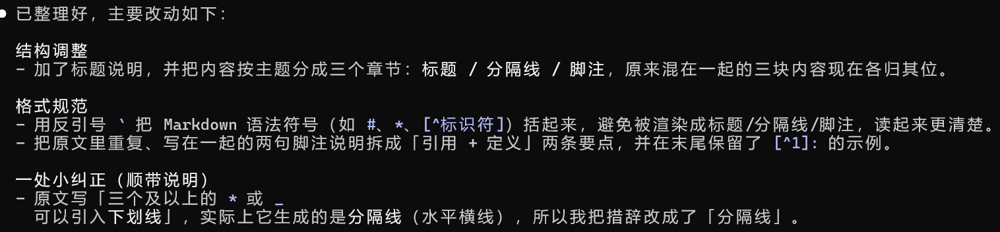

# AI Agent
## 任务1
1. 我使用的是Claude Code
2. 用命令行在终端安装好了Claude Code，下载了cc switch，在deep seek中生成了密钥接入Claude Code，使其能够正常使用。
3. 我让cc帮我整理了一份markdown文档，使其更条理清晰且具有专业性。
4. 
5. `git diff`中看到了ai修改的内容，以及关于换行符改动的提示。
6. 符合，使我的文档更加清晰有条理了，易于阅读。
***
## 任务2
1. agent通过调用外部工具来执行具体操作，而普通ai只能进行文本交互。
2. tool使agent能够跳出文本交互而执行具体操作。
3. 是为了防止agent越权操作、误用工具以及做出错误行为等，保障了使用agent时的安全问题。
4. 因为上下文窗口有限，当超出范围时，早期的对话记录就会遗失。
5. 会造成数据泄露、恶意病毒、权限滥用、误删文件等情况。